# Date Fruit Image Classification

**Talal Aloushan · CSC462 Machine Learning · King Saud University · November 2024**

## 1. Overview

Distinguishing date varieties by appearance is useful for automated sorting and quality control.
For this course project, I built and compared three image classification approaches: a custom
convolutional neural network, transfer learning with EfficientNetB0, and fine-tuning YOLO11n-cls.
The models classify images into nine date varieties, with the best model reaching **99.00%
validation accuracy**.

## 2. Results

| Model | Input size | Best logged validation accuracy |
| --- | --- | ---: |
| Custom CNN | 200 × 200 | 94.42% |
| EfficientNetB0 with frozen backbone | 224 × 224 | 96.22% |
| EfficientNetB0 fine tuning | 224 × 224 | 97.61% |
| **YOLO11n classification** | **224 × 224** | **99.00%** |

YOLO11n-cls achieved the strongest result after 20 training epochs. The final epoch reached
98.61% top-1 accuracy; the table reports each approach's best logged validation score.
The 502-image folder named `test` was used for validation during development, rather than
as an independent final test set.

### YOLO11 classification performance

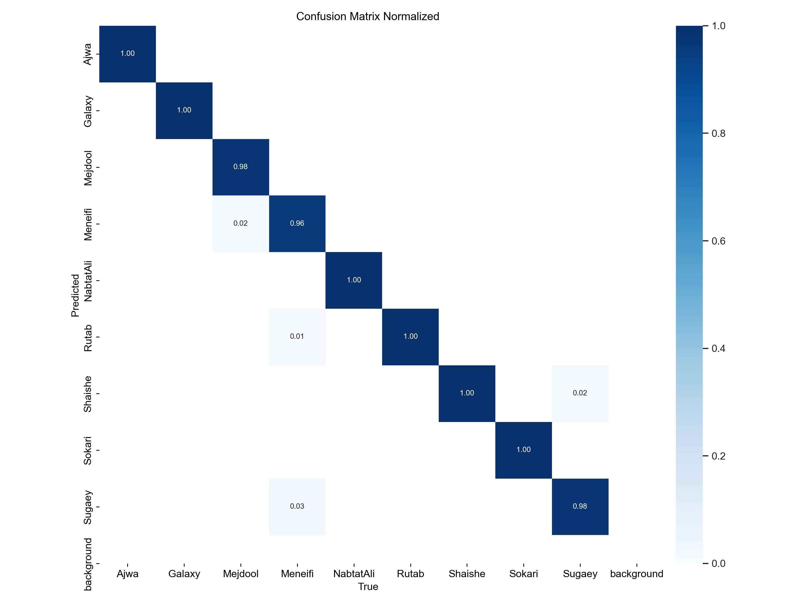

YOLO11 training loss and validation accuracy over 20 epochs

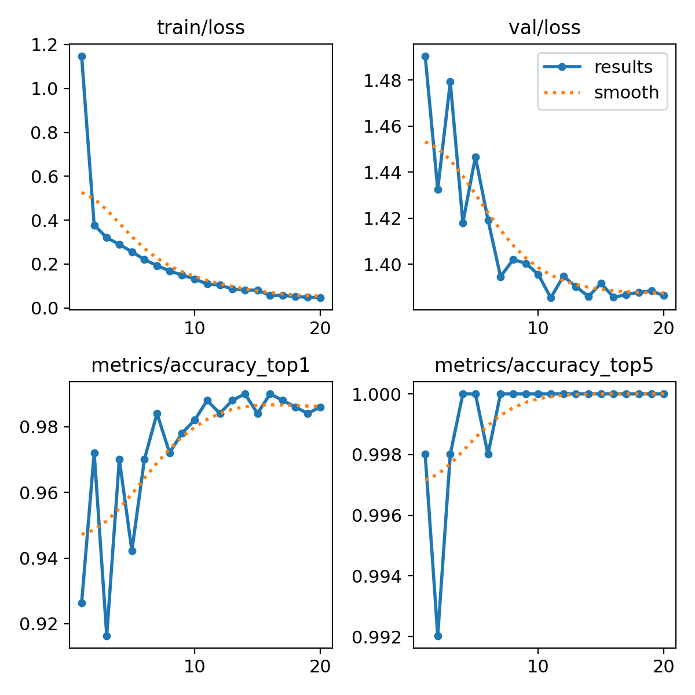

### EfficientNetB0 fine tuning

| Accuracy over 50 epochs | Loss over 50 epochs |
| :---: | :---: |
| 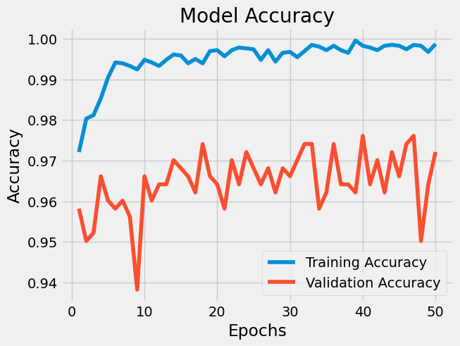 | 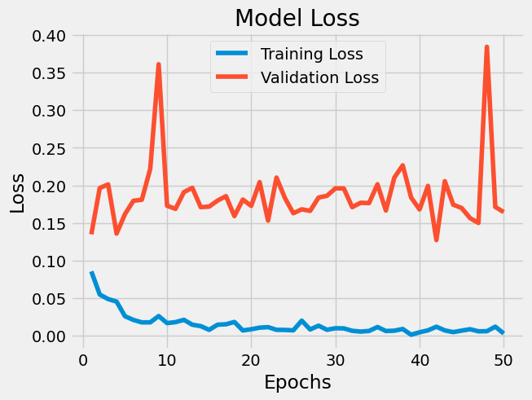 |

These figures come from the saved experiment outputs in the EfficientNetB0 notebook.

## 3. Approach

1. **Custom CNN:** I built a TensorFlow/Keras model with three convolution and pooling blocks,
   a 256-unit dense layer, dropout, and a nine-class softmax output. This established a baseline
   using pixel values scaled to the range 0–1.
2. **EfficientNetB0 transfer learning:** I started with ImageNet-pretrained weights and trained
   a new classification head with the backbone frozen. I then fine-tuned the final section of
   the backbone at a lower learning rate while keeping batch normalization layers frozen.
3. **YOLO11n classification:** I fine-tuned the pretrained `yolo11n-cls.pt` model using Ultralytics
   and PyTorch. This produced the best validation accuracy with a compact classification model.

I compared the models using validation accuracy, training curves, and confusion matrices.
The notebooks, saved YOLO run settings, and report document the experiments in more detail.

## 4. Dataset

The dataset contains **nine date varieties** from Kaggle. The original training split has
**1,156 images**. Vertical, horizontal, and combined flips expand it to **4,624 training images**;
the validation split contains **502 images**. Augmentation was applied to the training split only.

| Ajwa | Galaxy | Mejdool |
| :---: | :---: | :---: |
| 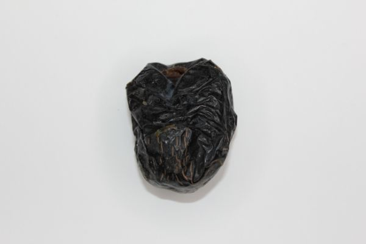 | 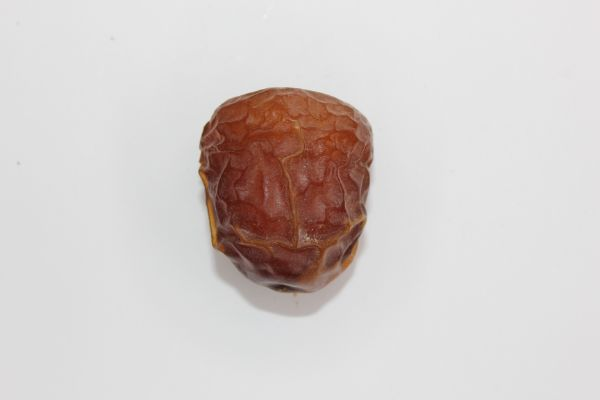 | 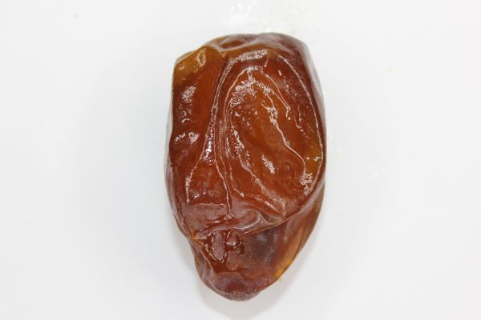 |
| **Meneifi** | **NabtatAli** | **Rutab** |
| 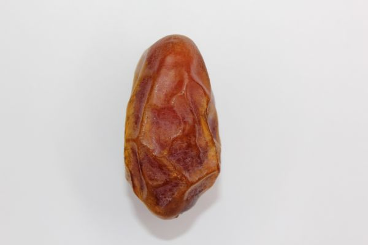 | 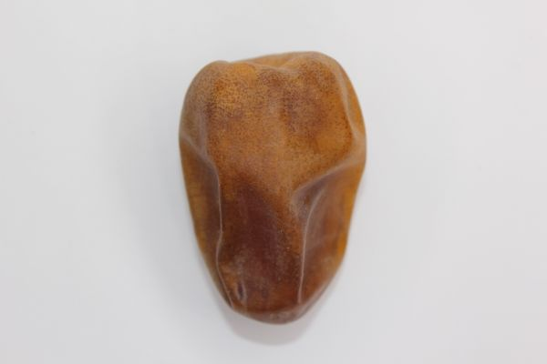 | 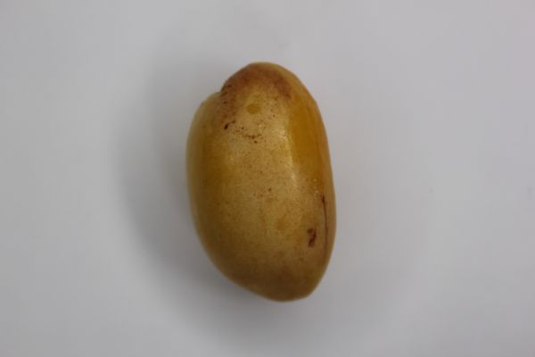 |
| **Shaishe** | **Sokari** | **Sugaey** |
| 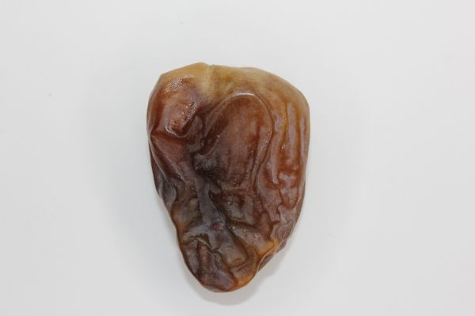 | 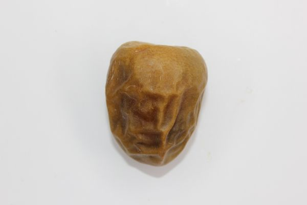 | 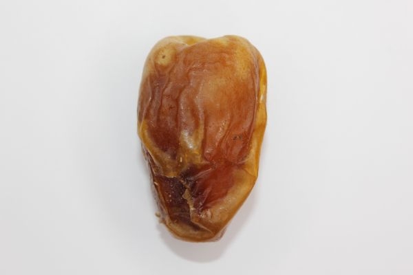 |

The images are included under `Date_Fruit_dataset/`. The exact Kaggle dataset link and source
license will be added later.

## 5. Project files

| File or folder | Contents |
| --- | --- |
| [Custom CNN notebook](Datefruit_cnn.ipynb) | Model architecture, training, evaluation, and confusion matrix |
| [EfficientNetB0 notebook](Datefruit_effecientb0.ipynb) | Frozen-backbone transfer learning and fine tuning |
| [Augmentation notebook](DateFruit-augmentation.ipynb) | Examples and generation of training image flips |
| [YOLO11 results](yolo11-cls/) | Trained weights, experiment settings, metrics, and plots |
| [Project report](report/Datefruit_project.pdf) | Detailed methodology and experiment results |
| [Presentation](presentation/Datefruit_project_presentaiton_talal.pptx.pdf) | Course project slides |

The original notebooks and their saved outputs are retained. Their dataset paths use
`Date_Fruit/`, while the included dataset folder is named `Date_Fruit_dataset/`.

---

**Author:** [Talal Aloushan](https://github.com/Talal1421)

The YOLO checkpoints retain the upstream [Ultralytics AGPL-3.0 notice](https://github.com/ultralytics/ultralytics/blob/v8.3.31/LICENSE).
